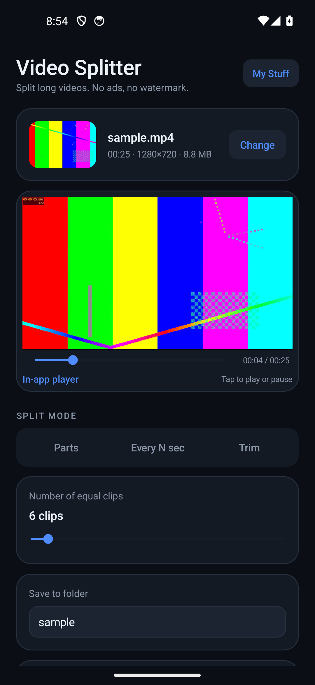
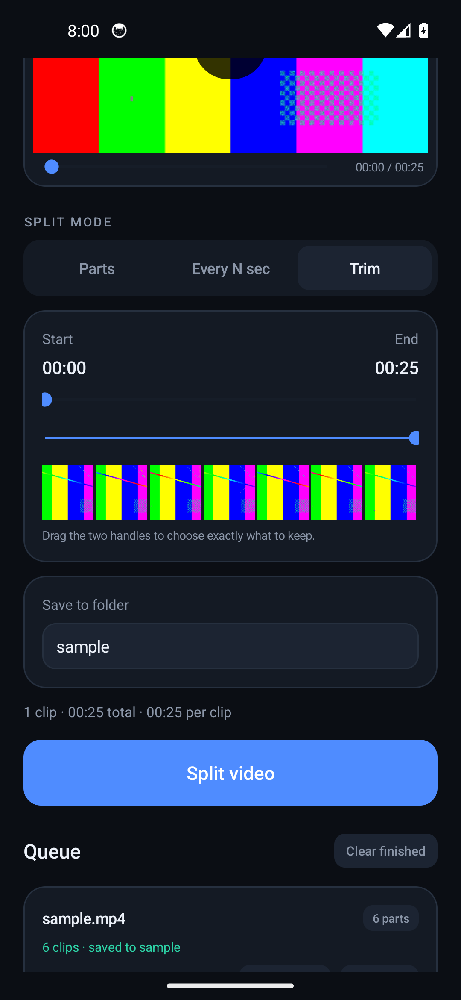
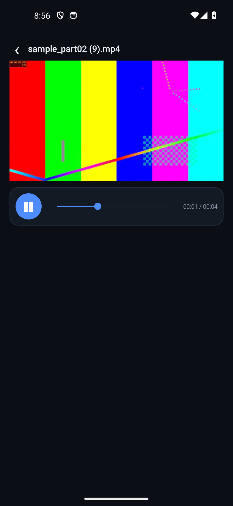
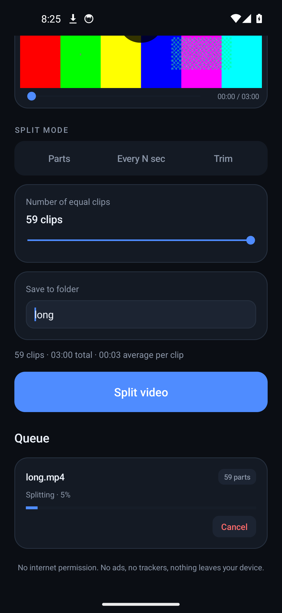
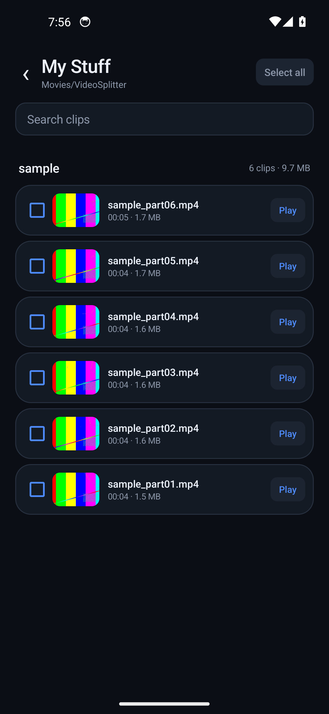
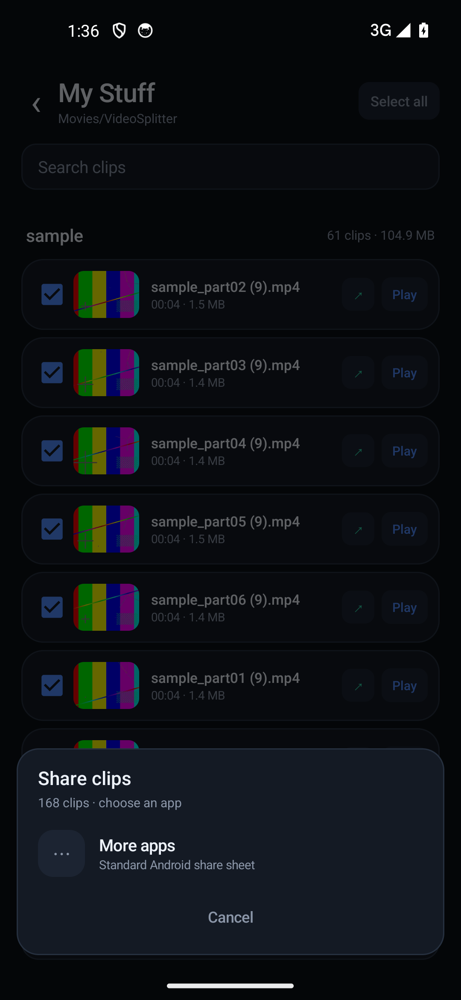

# VidSplit

**Split long videos into ready-to-post clips — entirely on your phone.**

No ads · no watermark · no premium · no trackers · no `INTERNET` permission.

VidSplit is an independent Android app written from scratch. It picks any video,
splits it by parts, fixed length or a trim range, and saves the clips to your
gallery. Everything runs on-device: there is no network code, no account, no
analytics and no ad SDK.

| | |
|---|---|
| Package | `com.opensplit.videosplitter` |
| Version | 3.4.0 (code 7) |
| Android | 10+ (minSdk 29, targetSdk 34) |
| Engine | FFmpegKit 6.0-2 (copy-first, re-encode fallback) + MediaMuxer fallback |
| Size | ~47 MB (`arm64-v8a` + `x86_64`); `ABIS=arm64-v8a` build ≈ 24 MB |

## Screenshots

| Main | Trim | In-app player |
|---|---|---|
|  |  |  |

| Queue | Library | Share |
|---|---|---|
|  |  |  |

## Features

### Split
- Pick any video through the system picker (persisted SAF grant)
- **Parts** — 2–60 equal clips
- **Every N sec** — 30/60/90 presets or any 5–300 s length
- **Trim** — start/end handles with a 7-frame thumbnail strip
- **Precise cuts** — re-encode for frame-accurate trims
- **Max resolution** — Original / 1080p / 720p / 480p (aspect preserved)
- Output folder per job: `Movies/VideoSplitter/<folder>/`
- Orientation metadata preserved

### Playback
- 100% in-app playback — no external player
- Inline preview in the editor (play/pause, seek, time)
- `PlayerActivity` for library playback, sized to the video’s aspect ratio
- Portrait videos stay tall (letterboxed, never cropped)

### Queue
- Foreground service with progress notification and cancel
- Persistent FIFO queue; interrupted jobs are reported, not silently lost
- Clips are published only after every segment succeeds — cancel leaves no partials

### Share
- Direct targets when installed: **WhatsApp Status**, WhatsApp, WhatsApp Business,
  Instagram, Facebook, Telegram
- **More apps** opens the standard Android chooser (single or multiple clips)
- Multi-select shares every selected clip (`ACTION_SEND_MULTIPLE`)
- Correct `ClipData` + read grants for every receiver

### Library (“My Stuff”)
- Groups clips by folder, search, totals
- Multi-select share/delete, play, async thumbnails

## Security & privacy

- **No `INTERNET` permission** (also no storage/contacts/location/camera/mic)
- Only 4 permissions: foreground service, data-sync FGS, notifications, wake lock
- One exported component (the launcher); service and other activities are
  `exported="false"`
- No ad/analytics/billing SDKs, no reflection, no dynamic code loading,
  no `Runtime.exec`, no WebView, no clipboard/keylogging APIs
- ClamAV scan of the shipped APK: **0 infected**

Full evidence: [`docs/security-audit.md`](docs/security-audit.md).

## Install

```bash
adb install -r VidSplit-3.4.0.apk
```

APKs are published under **Releases**. The default local build is signed with a
debug key; see the audit for the release-signing recommendation.

## Build

Requirements:
- JDK 17
- Android SDK **build-tools 34.0.0** and **platform android-34**
- `curl`, `unzip`

```bash
export ANDROID_SDK_ROOT=$HOME/android-sdk
./build.sh
```

On the first run `build.sh` calls [`scripts/fetch-deps.sh`](scripts/fetch-deps.sh),
which downloads the pinned FFmpegKit AAR and `smart-exception` jars and verifies
their SHA-256 before extracting `classes.jar` and the `arm64-v8a`/`x86_64`
libraries.

Thin production build:

```bash
ABIS=arm64-v8a ./build.sh
```

Pipeline: `aapt2 compile` → `aapt2 link` → `javac` → `d8` → add native libs →
`zipalign -p` → `apksigner`. No Gradle, no AndroidX, no Kotlin.

## Project structure

```
build.sh                     full APK pipeline
scripts/fetch-deps.sh        pinned FFmpegKit download + checksum
app/src/main/AndroidManifest.xml
app/src/main/java/com/opensplit/videosplitter/
  MainActivity.java          picker, modes, inline preview, queue UI
  PlayerActivity.java        in-app player
  FfmpegEngine.java          copy-first split engine + re-encode fallback
  Splitter.java              MediaMuxer fallback + MediaStore publishing
  SplitService.java          foreground service, notifications, wake lock
  QueueManager.java          persisted FIFO queue
  LibraryActivity.java       folders, search, multi-select, share/delete
  ShareSheet.java            direct share targets + Android chooser
  OnboardingActivity.java
  Job.java / Thumbs.java / Ui.java
app/src/main/assets/licenses/
docs/                        analysis, parity, security audit, REA evidence
screenshots/
```

## Docs

- [Original app analysis](docs/original-analysis.md)
- [Feature parity](docs/parity.md)
- [Security audit](docs/security-audit.md)
- [REA evidence bundle](docs/rea-evidence-videosplitter.json)

## Third-party

FFmpegKit `com.arthenica:ffmpeg-kit-video:6.0-2` (LGPL-3.0) is bundled
unmodified; license texts ship in `app/src/main/assets/licenses/`. Source:
<https://github.com/arthenica/ffmpeg-kit>. No GPL-only encoders (x264/x265) are
included; re-encode uses MediaCodec or MPEG-4.

See [`third_party/ffmpegkit/NOTICE.md`](third_party/ffmpegkit/NOTICE.md).

## Disclaimer

VidSplit is an independent implementation. It is not affiliated with, endorsed
by, or derived from the Play Store app “Video Splitter” by PSMA / photoshop+mobile
apps. No code, assets, fonts, icons, ad units or analytics from that app are used.
Feature behavior was studied from the shipped APK for interoperability and
re-implemented from scratch.